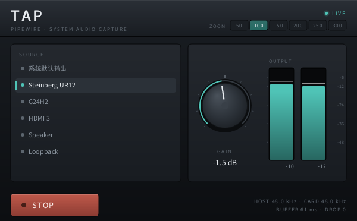

# TAP

**把电脑里正在播放的声音，像麦克风一样接进 DAW 的轨道。**
Linux / PipeWire 专用的 CLAP 插件。装上、点一下，轨道就开始长音频——不用虚拟声卡、不用 `parecord`、不用来回搬文件。



> 这个仓库以前叫 NeiLu，插件名太傻，改叫 **TAP**（从水管上接个龙头）。

## 只做一件事

取音。插件不录音、不写文件、不做编辑——落盘、剪辑、混音全用宿主自带的。
所以它没有：录音按钮的“保存到哪”、波形显示、导出。只有一个输入源、一个增益、两条电平。

## 为什么需要它

USB 声卡（比如 Steinberg UR12）在 Linux 上没有硬件 loopback，`dspMixFx` 那套是 Windows 驱动的功能。
想在 Linux 里内录，通常得命令行把 PipeWire 的 monitor 录成 wav 再拖回工程。

TAP 把这件事搬进插件：它自己作为 PipeWire 客户端去抓任意 Sink 的 monitor，
把音频吐到插件输出端口，「录进轨道」就变成普通的录音动作。

## 用法（REAPER 为例）

1. 在轨道上插入 **TAP**
2. 把该轨道录音模式改成 **Record: output (stereo)**，按录音键
3. 插件插入时就已经开始抓系统默认输出了；想换设备点左边的列表

想单独抓某个程序（浏览器、播放器）：把它指到某个输出设备，然后在列表里选那个设备。

## 界面

- **SOURCE**：`系统默认输出` + 每一个 PipeWire sink。点一行就切过去（正在抓的时候会无缝换）
- **GAIN**：±24 dB，拖动旋钮，右键回 0
- **OUTPUT**：两条电平 + 峰值保持，右边是 dB 刻度
- **CAPTURE / STOP**：开关
- **ZOOM**：`50 / 100 / 150 / 200 / 250 / 300 %`，尺寸按档位跳，不是自由拉伸
- 底栏显示宿主速率、声卡速率（不一致会标 `RESAMPLED`）、缓冲毫秒和丢帧数

## 安装

```bash
cargo build --release
./install.sh          # 装到 ~/.clap/tap.clap
```

然后在 REAPER 里：`Options → Preferences → Plug-ins → CLAP → Re-scan`，FX 浏览器搜 **TAP**。

依赖（Arch）：`rust`、`pipewire`、`libx11`、`noto-fonts-cjk`（或任何带中文的字体）。运行时不需要额外装任何东西。

## 采样率

插件**不强制**采样率：PipeWire 那边按声卡当前的图速率协商，协商结果回读到界面（`CARD`）。
如果声卡是 44.1 kHz 而工程是 48 kHz，插件自己重采样（线性插值 + 按缓冲填充量做 ±2% 的漂移补偿），
不会因为两边时钟不同步而慢慢积累成爆音。

## 工作原理

```
PipeWire 线程 ──pw_stream(sink monitor)──▶ 无锁环形缓冲 ──▶ 音频线程 ──▶ 插件输出端口
                                                     ▲
                                             按填充量微调播放速率
                                            （和 DAW 时钟的漂移补偿）
```

- 抓 monitor 用 `stream.capture.sink = true`；指定设备用 `target.object = <sink 的 node.name>`
- 捕获跑在 PipeWire 自己的实时线程里，只做一件事：把交错立体声写进环形缓冲，不分配内存、不加锁
- 音频线程按 60 ms 的缓冲目标微调速率，用线性插值重采样；积压超过 4 倍目标就直接跳帧
- 界面是 X11 子窗口 + tiny-skia 软件绘制（MIT-SHM 上屏），没有 GL 依赖，Hyprland / XWayland 下都能嵌进宿主窗口

## 已知限制

- 只支持 X11 窗口（Wayland 原生窗口没做，REAPER 本身走 XWayland 所以没问题）
- 只发 CLAP，不打算做 VST3 / LV2 —— `Cargo.toml` 里的 `rlib` 只是给 examples / 测试用，不是插件格式
- 只在 REAPER + PipeWire 1.6 / Hyprland 上验证过，其他 CLAP 宿主理论上也能用
- 没有 Windows / macOS 支持（这两边本来就不需要它）

## 开发

```bash
# 不开 DAW，直接验证 PipeWire 这一侧抓没抓到声音
cargo run --release --example probe
cargo run --release --example probe -- Loopback      # 抓指定 sink

# 重新渲染 README 的预览图（第二个参数是 ZOOM 档位 0..5）
cargo run --release --example preview -- docs/preview.png 1
```

## License

GPL-3.0-or-later
